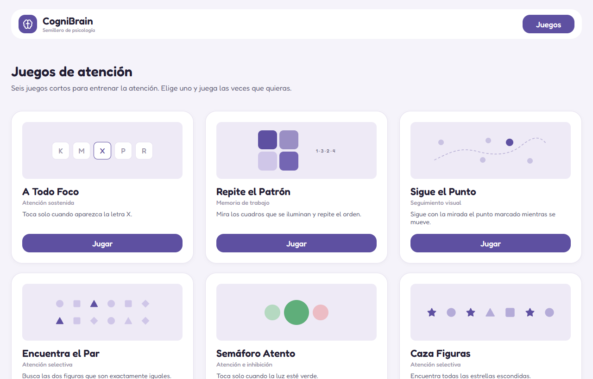

<div align="center">


# CogniBrain

**Seis juegos cortos para entrenar la atención.**
Un proyecto del semillero de psicología.

### [▶ Abrir CogniBrain](https://cognibrain.vercel.app)

https://cognibrain.vercel.app

</div>



CogniBrain es una página web con seis juegos breves que ejercitan distintas formas de atención y memoria. Cada partida dura unos pocos minutos y termina con una pantalla de resultados: aciertos, errores y tiempos de reacción.

No hace falta crear una cuenta ni instalar nada: se abre [cognibrain.vercel.app](https://cognibrain.vercel.app) y se juega.

## Características

- **Seis juegos de atención**, cada uno enfocado en una habilidad distinta.
- **Resultados al terminar** cada partida, con métricas claras y fáciles de leer.
- **Historial en el dispositivo:** las partidas terminadas quedan guardadas en la sección "Mis resultados".
- **Descarga en CSV** del historial, lista para abrir en Excel u hojas de cálculo.
- **Funciona sin internet** después de la primera visita.
- **Se puede instalar como app** en el computador o el celular.
- **Privada por diseño:** no pide nombre, correo ni ningún dato personal.
- **Adaptada a computador, tablet y celular**, con soporte para teclado y movimiento reducido.

## Los juegos

| Juego | Habilidad | Cómo se juega | Resultados |
| --- | --- | --- | --- |
| **A Todo Foco** | Atención sostenida | Aparecen letras una por una; se toca solo cuando sale la X (también con la barra espaciadora). | X que tocaste, X que se escapó, toques en otra letra, tiempo de reacción |
| **Repite el Patrón** | Memoria de trabajo | Cuatro cuadros se iluminan en un orden que hay que repetir. La secuencia crece de 2 a 9 colores. | colores seguidos que recordaste, rondas completadas, errores |
| **Sigue el Punto** | Seguimiento visual | Se marca un punto, todos se mueven y al final hay que tocar el que estaba marcado. | veces que lo seguiste, tiempo de respuesta |
| **Encuentra el Par** | Atención selectiva | Entre doce figuras hay solo dos iguales en forma y color. | pares encontrados, toques errados, tiempo promedio por ronda |
| **Semáforo Atento** | Atención e inhibición | Se toca cuando la luz está verde y se espera cuando está roja. | verdes que tocaste, verdes que se escaparon, rojas que tocaste, tiempo de reacción |
| **Caza Figuras** | Atención selectiva | En un tablero de figuras hay que encontrar las doce estrellas escondidas. | estrellas encontradas, estrellas sin encontrar, figuras equivocadas, tiempo total |

## Privacidad y resultados

- Los resultados se guardan **solo en el navegador del dispositivo** donde se jugó (con `localStorage`). No se envían a ningún servidor.
- Se conservan las últimas 100 partidas. Se pueden borrar en cualquier momento con **Borrar historial**.
- Con **Descargar CSV** se obtiene un archivo con una fila por métrica y las columnas `Fecha`, `Hora`, `Juego`, `Métrica`, `Valor`, `Total` y `Unidad`.
- Cada navegador y cada dispositivo tiene su propio historial.

## Instalar como app

Después de abrir la página una vez con internet:

- **Chrome o Edge en computador:** ícono **Instalar** en la barra de direcciones.
- **Android:** menú ⋮ → **Instalar app**.
- **iPhone o iPad (Safari):** Compartir → **Agregar a inicio**.

Desde ese momento CogniBrain abre y se juega sin conexión. Cuando hay una versión nueva, aparece un aviso para actualizar, que nunca interrumpe una partida en curso.

## Tecnologías

- [React 18](https://react.dev/) y [Vite](https://vite.dev/)
- [vite-plugin-pwa](https://vite-pwa-org.netlify.app/) (service worker con Workbox y manifest)
- Fuente [Fredoka](https://fontsource.org/fonts/fredoka) incluida en el proyecto
- CSS propio, sin frameworks de estilos
- Publicada en [Vercel](https://vercel.com/); cada cambio en `main` se publica solo

## Ejecutar el proyecto en tu computador

Esta sección es solo para quien quiera ver o modificar el código. Para jugar basta con el link de arriba.

Requiere [Node.js](https://nodejs.org/) 18 o superior.

```bash
git clone https://github.com/raesttleten/cognibrain.git
cd cognibrain
npm install
npm run dev
```

Se abre una copia local en http://localhost:5173, que solo funciona en ese computador mientras el comando está corriendo.

| Comando | Qué hace |
| --- | --- |
| `npm run dev` | Servidor de desarrollo con recarga automática. |
| `npm run build` | Genera la versión para publicar en `dist/`, con el service worker. |
| `npm run preview` | Sirve `dist/` en http://localhost:4173 para probar la versión final y el modo sin conexión. |
| `npm run build:single` | Genera `dist-single/index.html`: la página completa en un solo archivo que abre con doble clic, sin servidor ni internet. |

## Estructura

```
src/
  App.jsx          pantalla de inicio y navegación entre pantallas
  main.jsx         punto de entrada
  games/           un archivo por juego y el catálogo (index.jsx)
  components/      encabezado, instrucciones, resultados, historial y aviso de actualización
  storage.js       historial de resultados en el navegador
  csv.js           exportación del historial a CSV
  pwa.js           registro del service worker
  styles.css       estilos y colores
public/            íconos de la app
```
